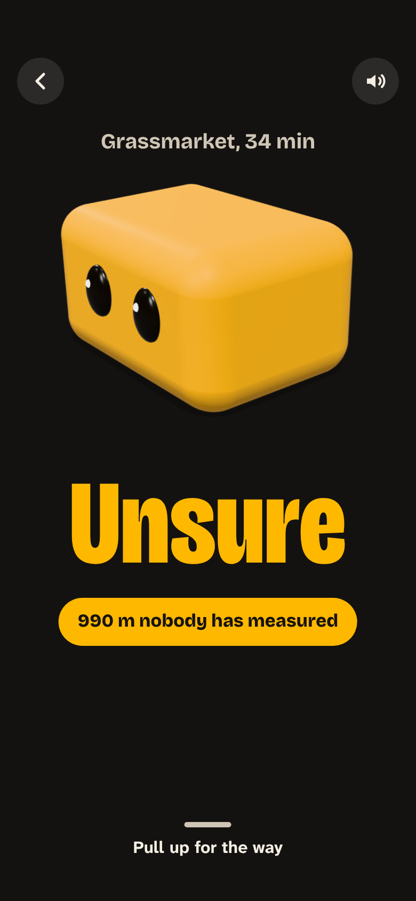
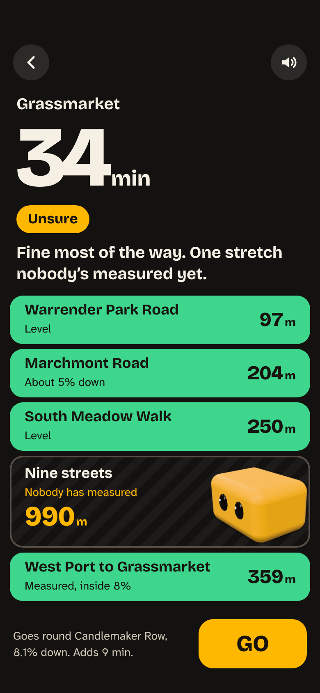

# Design v3: the route moment that unfolds

From Jonny (design) to the Claude Code sessions that build it. Written 23 November 2026.
Roadmap: FEAT-63 (this handoff), FEAT-64 to FEAT-69 (the build). Kick-off prompt: [DESIGN_V3_PROMPT.md](DESIGN_V3_PROMPT.md).

**See it move first.** Prototype: https://claude.ai/artifact/Y2FBKYeAhuK2Sw7PMrfdNP (swipe up, swipe down, Escape). Recording: [ux/v3/prototype/unfold-v1.mp4](../ux/v3/prototype/unfold-v1.mp4). Source: [ux/v3/prototype/index.html](../ux/v3/prototype/index.html). The prototype is the reference for feel and timing. The code here is the reference for data, accessibility and layout rules.

 

## Contents

1. [The idea](#the-idea)
2. [Done means](#done-means)
3. [Decisions taken for this build](#decisions-taken-for-this-build)
4. [Where it lives in the app](#where-it-lives-in-the-app)
5. [Data: from PlanResult to the screen](#data-from-planresult-to-the-screen)
6. [Tokens](#tokens)
7. [Components](#components)
8. [Motion](#motion)
9. [Every state](#every-state)
10. [Accessibility](#accessibility)
11. [Copy](#copy)
12. [The stone](#the-stone)
13. [Workstreams and order](#workstreams-and-order)
14. [Phase 2: the other flows](#phase-2-the-other-flows)
15. [Never](#never)
16. [Checks and the design review](#checks-and-the-design-review)

## The idea

Every screen in Causewayside answers "can I get there?" first (D-035). v3 makes that answer a moment, then lets the detail grow out of it.

- **The moment.** A route result opens on a dark ground with three things: the stone, one word (Fits, Unsure or Doesn't fit) and one flag naming what decided it ("990 m nobody has measured"). The destination and time sit above in small type.
- **The unfold.** Pull up, or press the button, and the moment becomes the detail in one continuous motion. The word shrinks into the verdict pill. The time grows into a big figure. The route rises underneath as street bands, one per stretch, in order. Measured streets are filled in their verdict colour. Streets nobody has measured stay unlit.
- **The stone walks.** As the bands arrive, the stone shrinks and hops onto the unlit band: the stretch it can't vouch for. On a route that fits, it sits on the last band, at the destination. On a route that doesn't fit, it sits on the band with the blocker.

Why it works: the first thing anyone sees is the answer and its reason, with nothing else competing (Hick's law, Von Restorff). The detail comes when asked for (progressive disclosure, Tesler's law). The moment is memorable, the detail is fast to scan (peak-end rule). The stone carries no words and decorates nothing: it is a pointer to the one stretch that matters.

## Done means

- A person on the phone layout, with the `v3` flag on, gets the moment for a new route result, can unfold and fold it by swipe, button and keyboard, and sees bands built from the router's real output.
- Every figure on screen comes from `PlanResult`. Nothing is hard-coded.
- With the flag off, the app is byte-for-byte the current behaviour.
- Light, dark, 320 px wide, 200% text, reduced motion, VoiceOver and TalkBack all pass the checks below.
- Screen recordings of the unfold on a phone viewport are on the PR, beside the prototype recording.
- Richard has seen the recording and said yes before the flag defaults on.

## Decisions taken for this build

Richard asked for the build to start now. These defaults let it start. Each is easy to reverse and is listed in [OPEN_ITEMS.md](../OPEN_ITEMS.md) for him to overturn. Record them as one decision with the next free D-number when FEAT-64 merges (D-086 and D-087 are taken by open PRs; check `main` and open PRs again at merge).

| Question | Default for v3 | Why | Reverse by |
|---|---|---|---|
| Controls at the top (Back, Read aloud) | Move to the bottom bar, beside GO | D-035: nothing you must tap sits at the top | n/a, keeps D-035 |
| Display typeface | Bricolage Grotesque for the time, the verdict word and street names; Atkinson for everything else | It is the approved look. Numbers and names at 18 px and up stay distinct | Set `--font-display: var(--font-sans)` |
| Mono uppercase section labels | Not used on v3 surfaces; plain headings | The v3 language has none; existing screens keep theirs | Restyle headings |
| When the moment shows | For a new route result. A route you return to opens unfolded | The moment is for the answer, not for every visit | One condition in `RouteMoment` |
| "Tell me when someone measures it" alert | Out of this build. Row FEAT-69 notes it | Needs notifications and a backend | n/a |
| Undo after sending a report | In phase 2, local only (withdraw within 10 s) | Cheap, kind, no backend change | Remove the button |

## Where it lives in the app

- **Behind a flag.** `v3` on when the URL has `?v3` (then remembered in `localStorage` as `cw-design-v3`) or `NEXT_PUBLIC_DESIGN_V3=1`. Off by default. Read it once in `apps/web/src/lib/design-flag.ts`.
- **Phone first.** On the phone layout the moment replaces the half-open sheet for a new route result; unfolding opens the sheet at 94% with the bands. Desktop (≥ 768 px) keeps today's docked panel and shows the bands inside the route card, with no moment. Phase 2 can revisit desktop.
- **The map stays.** In the moment, the map dims behind the ground at 92% opacity, so the route line is still faintly visible. Unfolded, the sheet covers it as today.
- **The strip stays.** The route strip (`RouteStrip.tsx`) remains on the collapsed card and the other-ways rows. Street bands are the strip opened out: same order, same data, one row per stretch.

## Data: from PlanResult to the screen

All from `PlanResult` and `PlannedRoute` in `apps/web/src/lib/plan-types.ts`. Build bands in the worker, next to `stretchesOf`, as a pure function with tests.

### Verdict

| `summary.verdict` | Word | Fill | Stone |
|---|---|---|---|
| `passable` | Fits | `--ok-fill` | `fits` |
| `passable-with-unknowns` | Unsure | `--caution-fill` | `unsure` |
| `not-passable`, or `status: "none"` | Doesn't fit | `--stop-fill` | `nope` |

### The flag (one line under the word)

| Verdict | Flag |
|---|---|
| Unsure | `{summary.unknownM rounded to 10 m} m nobody has measured` |
| Doesn't fit | The first blocker in words: `{blocker.detail} on {blocker.name}` (from `status: "none"`) |
| Fits | Steepest part: `Steepest {abs(worstInclinePct)}%, on {worstInclineAt}`. If nothing over 3%: `Level all the way` |

### Street bands: `streetBands(route): StreetBand[]`

Walk `route.steps` in order and group consecutive steps by street name (unnamed paths join the stretch before them). For each group:

```ts
interface StreetBand {
  name: string;            // street name, or "Nine streets" when unknowns merge (below)
  m: number;               // metres, rounded to whole metres
  state: "measured" | "unknown" | "blocked" | "ride";
  steepestPct: number | null;  // signed, + uphill, from the steps' evals
  condition: string;       // one short line, see Copy
  edgeIds: number[];       // to light the stretch on the map when the band is focused
}
```

- `unknown` when more than half the group's metres carry a critical unknown (the same test that feeds `summary.unknownM`).
- **Merge runs of unknown bands** into one: name becomes the count in words ("Nine streets"), `m` the sum, and keep the list of names for the expanded band and for screen readers.
- `blocked` only for the `status: "none"` closest route, on the group with the blocker.
- `ride` for bus, tram and train legs, named by line ("Bus 23 to Tollcross").
- The bands' metres must add up to `summary.walkM` within rounding. Test it.

### Notes under the bands

One line, only when it applies, from `PlanResult.avoided` and `minutesExtra`: `Goes round {name}, {detail}. Adds {n} min.` Everything else stays in "On this route" (D-067).

## Tokens

Ready to paste: [ux/v3/tokens.css](../ux/v3/tokens.css). Additions only. Contrast figures are in the file.

| Token | Value | Use |
|---|---|---|
| `--moment-ground` | `#141210` | Ground of the moment and the unfolded sheet |
| `--moment-ink` / `--moment-muted` | `#F5EFE4` / `#CFC6B6` | Text on the ground |
| `--ok-fill` / `--caution-fill` / `--stop-fill` | `#3DD68C` / `#FFB800` / `#FF4E2E` | Band fills, pill, flag, GO |
| `--fill-ink` | `#17130F` | All text on a fill |
| `--unknown-edge` | `#80756A` | Outline of an unlit band |
| `--font-display` | Bricolage Grotesque | Time, verdict word, street names |

Sizes stay in rem so they follow the phone's text size. Targets: 48 px minimum, GO 56 px or more.

## Components

All in `apps/web/src/components/v3/`. Each takes data, never fetches.

### `Stone`
```ts
{ state: "fits" | "unsure" | "nope" | "fog"; size: number; idle?: boolean }
```
- `` from `/stone/stone-{state}@2x.webp` (and 3x via `srcset`).
- Idle bob only when `idle` and motion is allowed.
- Acceptance: never the only signal of anything; swapping state cross-fades in 200 ms.

### `VerdictPill` (existing, add `variant="fill"`)
- Keeps its icon (CircleCheck, CircleHelp, CircleX) and word. Colour is never alone.

### `StreetBand`
```ts
{ band: StreetBand; verdict: "fits" | "unsure" | "nope"; onFocusBand?: (edgeIds: number[]) => void }
```
- Filled: `--{verdict}-fill`, `--fill-ink` text, name in display type, condition below, metres right-aligned in tabular figures.
- Unknown: transparent, 2 px `--unknown-edge` outline, diagonal hatch, name and "Nobody has measured" in `--caution-fill`, metres large under the text (the stone sits on the right).
- Blocked: `--stop-fill`, with the blocker in the condition line.
- A band is a `<li>` inside an `<ol aria-label="The way, street by street">`. Focusable only if it does something (it lights its stretch on the map).
- Acceptance: wraps at 320 px and 200% text; never scrolls sideways; metres never wrap.

### `RouteMoment`
```ts
{ plan: PlanResult; route: PlannedRoute; isNew: boolean; onUnfold: () => void }
```
- Destination and time line, the stone (large, idle), the word, the flag, and a button: "Pull up for the way" (`aria-expanded`, `aria-controls`).
- The word is the page's `h1` while the moment shows.
- Acceptance: the word, flag and button are reachable and read in that order; swipe up of 40 px or more unfolds; a tap anywhere outside the controls does nothing.

### `RouteUnfold`
- Owns the two states and the transition between them, wraps `RouteMoment` and the unfolded content (header, bands, note, bottom bar).
- The unfolded header: destination, time as a big figure, the pill, one sentence (see Copy).
- Bottom bar: Back, Read aloud, GO. Nothing tappable at the top (D-035).
- The hidden state is `inert`. A polite live region announces "Showing the way, street by street" and "Showing the verdict". Focus moves to GO on unfold and to the button on fold.
- Swipe down, Back and Escape fold it.

## Motion

Timings match the prototype. Use CSS transitions or the Web Animations API; no animation library needed. Everything below turns into a 200 ms cross-fade under `prefers-reduced-motion`.

| Step | Duration | Delay | Easing |
|---|---|---|---|
| Destination line fades | 180 ms | 0 | ease |
| Verdict word shrinks towards the pill, fades | 700 ms | 0 | `--ease-out` |
| Header (time, pill, sentence) arrives | 400 ms | 260 ms | `--ease-out` |
| Bands rise 60 px, one after another | 600 ms each | 180 ms, then +60 ms per band | `--ease-out` |
| Stone shrinks | 350 ms | 0 | `--ease-out` |
| Stone hops to its band | 700 ms | 200 ms | `--ease-hop` |
| Bottom bar arrives | 600 ms | 500 ms | `--ease-out` |
| Stone idle bob | 3.2 s loop | | ease-in-out, 8 px, 1.5° |

- Folding reverses with no delays and no stagger.
- More than eight bands: stagger only the first eight; the rest arrive together.
- The stone's target is measured from the target band's box after layout, not hard-coded.
- 60 fps on a mid-range Android: animate `transform` and `opacity` only.

## Every state

| State | What shows |
|---|---|
| Fits | Mint pill and bands; flag is the steepest part; stone on the last band |
| Unsure | Saffron pill; unlit band(s); stone on the first unlit band |
| Doesn't fit (`status: "none"`) | Tomato word and flag naming the blocker; unfolding shows the closest route's bands with the blocked band, then today's "What you can do" options (D-035, NoFit) styled in v3 |
| Planning | No moment yet. Keep today's loading state |
| Offline or a live feed failed | Today's caution line, placed under the bands |
| Several routes | The moment shows the selected route. Unfolded, other ways sit under the bands as today's 56 px rows with their own pills |
| Returning to a route | Opens unfolded, no moment |
| Large text (root ≥ 20 px) | Moment stacks: smaller stone, word wraps; unfolded opens full height (as today) |
| Light theme | The moment and bands stay on `--moment-ground` (a night scene by design). Device, saved and report screens use the light drench grounds |

## Accessibility

- WCAG 2.2 AA. Fill text contrast is in the tokens file. The unlit band's edge is 4.2:1.
- Reading order in the moment: word (h1), flag, destination and time, button. Unfolded: header, bands as a list, note, bottom bar.
- Each band is read as one item: "Marchmont Road, about 5% down, 204 metres." Merged unknowns: "Nine streets nobody has measured, 990 metres: Leven Terrace, Lonsdale Terrace, …".
- The stone is decorative. The verdict is always a word and an icon.
- Swipe is never the only way: the button and Escape do the same.
- `pnpm a11y` must pass on both states.

## Copy

British English, short, no em dashes.

- Button: "Pull up for the way". Folded hint after the first use: none.
- Unfolded sentence: Fits "Fits all the way.", Unsure "Fine most of the way. {n} nobody's measured yet." ({n} = "one stretch" or "{count} stretches"), Doesn't fit "{blocker} stops this way."
- Band conditions: from the steepest part and surface. "Level", "About 5% down", "About 7% up", "Setts, about 4% up". Use "about" for any slope; round to whole per cent.
- Unknown band: "Nobody has measured".
- Note: "Goes round Candlemaker Row, 8.1% down. Adds 9 min." (example; real values from `avoided`).

## The stone

- A sett, the Edinburgh causey stone, with two eyes. Four states: `fits` (mint, eyes forward), `unsure` (saffron, eyes to the side), `nope` (tomato, eyes down), `fog` (pale, for unmeasured).
- Renders: [ux/v3/stone/](../ux/v3/stone/), 676 × 550 PNG with transparency. Convert to WebP at 2x and 3x for `apps/web/public/stone/`.
- Source: `render.html` (three.js 0.170, `?c=<hex>&look=<side|front|down|up>`) and `shoot.py` (Playwright). Needs three.js at `./three` beside the page and a local server on port 8765. Re-render rather than editing the PNGs.
- Rules: the stone only shows the route's state. It sits beside text, never instead of it, and never speaks.

## Workstreams and order

FEAT-64 is the coordinator's row. The others can run in parallel once FEAT-65 lands. Each is its own PR, claimed and logged as CLAUDE.md says.

| Row | Workstream | Depends on | Output |
|---|---|---|---|
| FEAT-65 | Tokens, flag, stone assets | none | `tokens.css` merged into `globals.css`, `design-flag.ts`, WebP stones in `public/stone/` |
| FEAT-66 | `streetBands()` in the worker, with tests | none | Pure function, tests including the metres sum and unknown merging, Grassmarket fixture |
| FEAT-67 | `Stone`, `StreetBand`, `VerdictPill` fill variant | FEAT-65 | Components with stories or a test page at `/v3-lab` (flag only) |
| FEAT-68 | `RouteMoment`, `RouteUnfold`, wiring into `RoutePanel` behind the flag | FEAT-66, FEAT-67 | The feature, end to end |
| FEAT-69 | Accessibility, visual tests, recordings | FEAT-68 | `pnpm a11y` on both states, screenshots at 320 px, 200% text, light, dark; recordings on the PR |

The coordinator keeps one tracking comment on FEAT-64's PR with each row's status, and merges in this order: 65, 66, 67, 68, 69.

## Phase 2: the other flows

After FEAT-68 is reviewed. Stills (older Drench style, use for content and layout, restyle in v3): [ux/v3/screens/](../ux/v3/screens/).

- **Map:** the route line in verdict fills with a dark casing; unmeasured stretch dotted; street names as tags on the line; the stone sits on the unmeasured stretch. ([Map.png](../ux/v3/screens/Map.png))
- **Device:** "How do you get around?" with the 13 presets from `packages/profile`. The chosen one fills with `--caution-fill` and shows its real limits large. ([Device.png](../ux/v3/screens/Device.png))
- **Saved:** saved places as verdict cards; saving is a stone moment ("Saved."). ([SavedList.png](../ux/v3/screens/SavedList.png), [SavedPeak.png](../ux/v3/screens/SavedPeak.png))
- **Report:** three taps as D-084 says. First tap is a stone moment, Good (mint) or Bad (tomato); second is the category list on that colour; third sends. "Noted" moment after, with local Undo. ([ReportChoose.png](../ux/v3/screens/ReportChoose.png), [ReportType.png](../ux/v3/screens/ReportType.png), [ReportNoted.png](../ux/v3/screens/ReportNoted.png))

Add a row per flow when phase 2 starts.

## Never

- Never use a figure from the stills. They show the Grassmarket example. **The manual wheelchair kerb limit is 6 mm (D-054), not the 6 cm the device still shows.** The stills' five device names are invented; the 13 presets are real.
- Never change the router's results, costs or verdicts for this work.
- Never put a control the user must tap at the top of the screen.
- Never let colour or the stone carry meaning alone.
- Never ship with the flag on by default before Richard has seen the recording.
- Never claim "step-free" while anything is unknown (the trust contract).

## Checks and the design review

- `pnpm typecheck`, `pnpm test`, `pnpm --filter @causeway/web typecheck`, `pnpm web:build && pnpm a11y`.
- Light, dark, 320 px, 200% text, reduced motion, VoiceOver (iOS Safari) and TalkBack (Chrome) reading order.
- A screen recording of fold and unfold at 390 × 844 on the PR, and stills of both states, side by side with the prototype's.
- Design review: post the recording and stills on FEAT-64's PR and ask Richard. He looks for: does it hold up beside the prototype; is the answer the first thing you read; does the stone land on the right band; is anything on screen not from the router.
- `pnpm audit --audit-level high` currently fails on `main` for existing dependencies. That is not this work's to fix; say so once on the PR.
